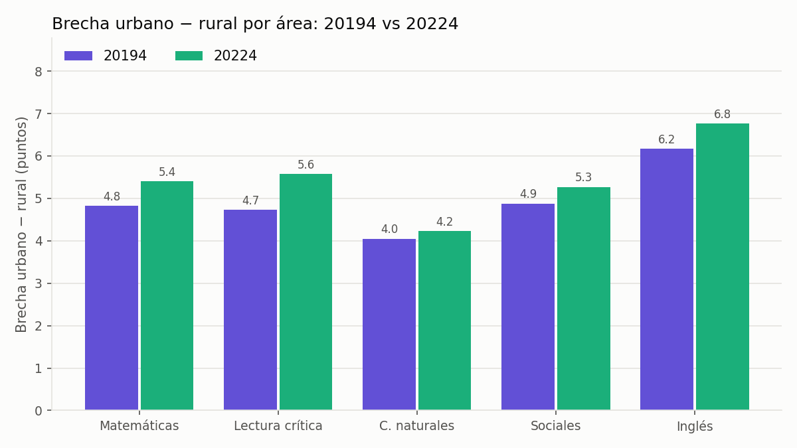

# Laboratorio 5. Contenedores y reproducibilidad

Repositorio de referencia del Laboratorio 5 del curso Computación en la Nube para Análisis de Datos (Unidad 6: contenedores y reproducibilidad). Contiene un análisis de datos empaquetado en una imagen Docker, versionado con Git y verificable mediante huellas SHA-256 de sus salidas.

## Proyecto: brecha rural vs urbana en Saber 11

Además del laboratorio, el repositorio contiene el proyecto del grupo en la carpeta [`proyecto/`](proyecto/). Compara los resultados de Saber 11 entre colegios urbanos y rurales en 2022 (532.791 estudiantes) y en 2019, antes de la pandemia (546.211 estudiantes), con los datos abiertos del ICFES en datos.gov.co, y corre completo en Docker.

Principales resultados:

- En 2022 los estudiantes de colegios rurales obtienen en promedio **26 puntos menos** en el puntaje global (228,4 frente a 254,6). La diferencia es estadísticamente significativa y tiene un efecto mediano (d de Cohen = 0,52).
- Dentro del mismo tipo de colegio y estrato la brecha **se mantiene, pero baja a 17,5 puntos**.
- La brecha aparece en todas las áreas y es mayor en **inglés** (6,8 puntos).
- **La brecha creció entre 2019 y 2022**, de 23,7 a 26,2 puntos: los dos grupos mejoraron, pero los rurales menos. Aumentó en todas las áreas, en todos los estratos y en 26 de 32 departamentos. Dentro del mismo tipo de colegio y estrato, el aumento es de 1,2 puntos.
- En los colegios oficiales la brecha es de 24 puntos; en los no oficiales se invierte. Es mayor en Guainía, San Andrés, Amazonas, Sucre y La Guajira, aunque los tres primeros suman menos del 1 % de los rurales; Antioquia, Córdoba, Cauca, Bolívar y Nariño concentran más estudiantes afectados.



Detalle completo, método y cómo reproducirlo: [proyecto/README.md](proyecto/README.md)

## Estructura

```
lab05_reproducibilidad/
├── .devcontainer/
│   └── devcontainer.json      Definición declarativa del entorno para GitHub Codespaces
├── src/
│   ├── generar_datos.py       Generación sintética y reproducible del conjunto de viajes
│   ├── analisis.py            Resumen por ciudad, gráfica y manifiesto de huellas
│   └── verificar.py           Comparación de manifiestos entre dos corridas
├── datos/                     Conjunto de datos generado (no se versiona)
├── salidas/                   Salidas del análisis (no se versionan)
├── Dockerfile                 Receta de la imagen
├── requirements.txt           Dependencias con versión fijada
├── ejecutar_analisis.sh       Punto de entrada del contenedor
├── reproducir.sh              Construcción, doble ejecución y verificación
├── .dockerignore
└── .gitignore
```

## Ejecución mínima

Entorno de referencia: terminal Linux con Docker Engine 24 o superior y Python 3.12 (GitHub Codespaces o Google Cloud Shell).

```bash
docker build --tag lab05-viajes:1.0 .
docker run --rm --volume "$(pwd)/salidas:/app/salidas" lab05-viajes:1.0
```

Salida esperada al final de la ejecución: tabla resumen de cinco ciudades y tres huellas SHA-256, una por archivo de salida.

## Verificación de reproducibilidad

```bash
./reproducir.sh
```

Salida esperada en la última línea:

```
Reproducción exacta: 3 de 3 salidas coinciden.
```

## Versiones de referencia

| Componente | Versión |
|---|---|
| Imagen base | python:3.12-slim-bookworm |
| numpy | 2.1.3 |
| pandas | 2.2.3 |
| pyarrow | 17.0.0 |
| matplotlib | 3.9.2 |

Fecha de referencia: septiembre de 2026. Las versiones se fijan en `requirements.txt`; toda actualización debe registrarse allí y validarse con `./reproducir.sh`.

## Integrantes y roles

- R1 y R2, responsable del repositorio y de datos: Cristian Puerto (@cristian12ss23)
- R3, responsable de análisis: Esteban Díaz (@diazesteban1001-sudo)
