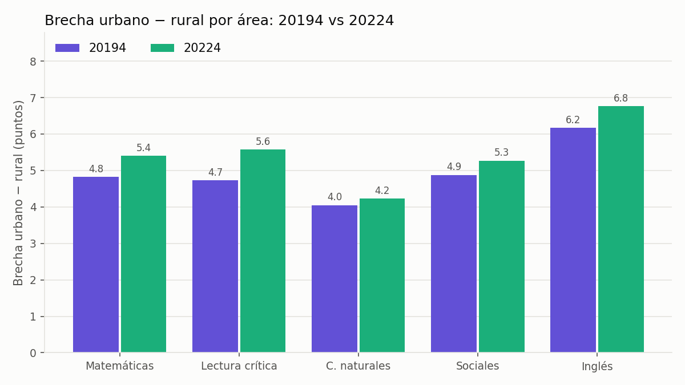
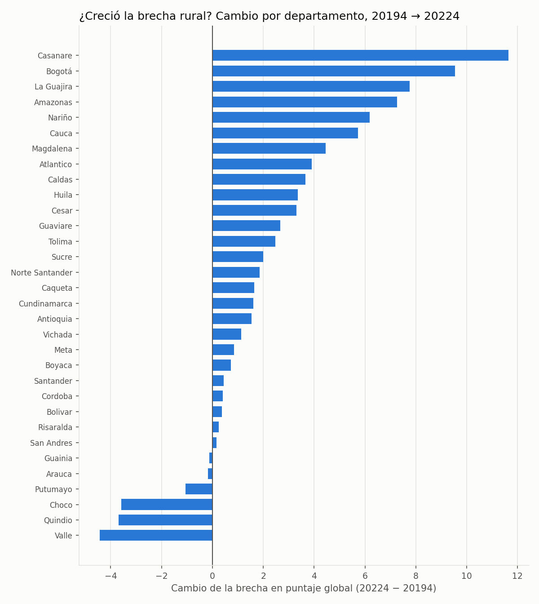

# Proyecto: Brecha rural vs urbana en Saber 11

## Pregunta de análisis
¿Cuántos puntos de diferencia hay en Saber 11 entre los estudiantes de colegios urbanos y rurales en Colombia? ¿La brecha se mantiene cuando se compara dentro del mismo tipo de colegio (oficial o no oficial) y del mismo estrato? ¿En qué departamentos es más grande? ¿Cambió entre 2019, antes de la pandemia, y 2022?

El resultado sirve para orientar dónde focalizar programas e inversión en la educación rural.

## Fuente de datos
- Conjunto: Resultados únicos Saber 11
- Entidad: ICFES, publicado en datos.gov.co
- Enlace: https://www.datos.gov.co/Educaci-n/Resultados-nicos-Saber-11/kgxf-xxbe
- Licencia: Creative Commons Atribución-CompartirIgual 4.0 Internacional (CC BY-SA 4.0)
- Periodos analizados: `20224` (2022, calendario A, el más reciente del conjunto) y `20194` (2019, calendario A, antes de la pandemia)

Los datos se descargan con la API pública de datos.gov.co, filtrados por periodo y solo con las columnas necesarias. No se versionan: se regeneran con el contenedor.

**Calidad de los datos.** En los periodos 20194 y 20224 el conjunto trae a cada estudiante dos veces: en 20224 hay 1.065.888 filas, pero solo 532.792 identificadores de estudiante distintos (`estu_consecutivo`). Las filas repetidas son copias idénticas, así que el análisis las quita antes de calcular. Esto no cambia los promedios, pero sí los conteos.

## Variables
| Variable | Uso |
|---|---|
| `estu_consecutivo` | Identificador del estudiante (para quitar repetidos) |
| `cole_area_ubicacion` | Zona del colegio: URBANO o RURAL (variable de comparación) |
| `punt_global` | Puntaje global, 0 a 500 (variable principal) |
| `punt_matematicas`, `punt_lectura_critica`, `punt_c_naturales`, `punt_sociales_ciudadanas`, `punt_ingles` | Puntajes por área, 0 a 100 |
| `cole_naturaleza` | OFICIAL o NO OFICIAL (para comparar dentro del mismo tipo de colegio) |
| `fami_estratovivienda` | Estrato del estudiante (para comparar dentro del mismo estrato) |
| `cole_depto_ubicacion` | Departamento (para ver dónde la brecha es mayor) |

## Método
1. `src/descargar.py` descarga el periodo y lo guarda en `datos/` ordenado de forma fija, para que dos descargas iguales tengan la misma huella SHA-256.
2. `src/analisis.py` quita los estudiantes repetidos, limpia los puntajes y calcula, en `salidas/<periodo>/`:
   - Resumen por zona: estudiantes, media, mediana y desviación del puntaje global, y media por área.
   - Brecha urbano − rural según tipo de colegio, estrato y departamento (departamentos con al menos 100 estudiantes rurales).
   - Prueba t de Welch, intervalo de confianza del 95 % de la diferencia y tamaño del efecto (d de Cohen).
   - Tres gráficas: distribución del puntaje global, promedio por área y brecha por departamento.
   - `manifiesto.json` con las filas quitadas, la huella SHA-256 de los datos y de cada salida, y las versiones de las bibliotecas.
3. `src/comparar.py` pone lado a lado los dos periodos en `salidas/comparacion/`: brecha global y por área, por tipo de colegio y por departamento, con dos gráficas.

Una copia de las gráficas está en `figuras/` para mostrarlas en este README.

## Herramientas
- pandas y scipy para el análisis, matplotlib para las gráficas.
- Docker para fijar el entorno, con versiones exactas en `requirements.txt`.

## Cómo reproducir
Desde la raíz del repositorio, en el codespace:

```bash
docker build --tag proyecto:0.3 proyecto/

# 2022
docker run --rm -e PERIODO=20224 \
  --volume "$(pwd)/proyecto/datos:/app/datos" \
  --volume "$(pwd)/proyecto/salidas:/app/salidas" \
  proyecto:0.3

# 2019
docker run --rm -e PERIODO=20194 \
  --volume "$(pwd)/proyecto/datos:/app/datos" \
  --volume "$(pwd)/proyecto/salidas:/app/salidas" \
  proyecto:0.3

# Comparación
docker run --rm --entrypoint python \
  --volume "$(pwd)/proyecto/salidas:/app/salidas" \
  proyecto:0.3 src/comparar.py
```

Cada descarga trae cerca de un millón de filas y tarda varios minutos. Las ejecuciones siguientes reutilizan los CSV de `datos/`.

## Resultados 2022 (periodo 20224)

Se analizaron **532.791 estudiantes**: 441.577 de colegios urbanos y 91.214 de colegios rurales.

### 1. La brecha general es de 26 puntos
| Zona | Estudiantes | Media global | Mediana | Desv. estándar |
|---|---|---|---|---|
| Urbano | 441.577 | 254,63 | 252 | 51,58 |
| Rural | 91.214 | 228,39 | 222 | 47,39 |
| **Brecha (U − R)** | | **26,24** | **30** | |

- Prueba t de Welch: diferencia de 26,24 puntos, intervalo de confianza del 95 % entre 25,90 y 26,58, valor p menor que 0,001. La diferencia no se explica por azar.
- Tamaño del efecto: d de Cohen = 0,52, un efecto **mediano**. La brecha es real y además importante en la práctica.


### 2. Todas las áreas muestran brecha; la mayor es en inglés
| Área | Urbano | Rural | Brecha |
|---|---|---|---|
| Inglés | 51,01 | 44,25 | **6,76** |
| Lectura crítica | 53,75 | 48,18 | 5,57 |
| Matemáticas | 51,51 | 46,12 | 5,40 |
| Sociales | 48,60 | 43,34 | 5,27 |
| C. naturales | 49,81 | 45,58 | 4,23 |


### 3. Según el tipo de colegio, la brecha cambia de sentido
| Tipo de colegio | Estudiantes rurales | Media urbano | Media rural | Brecha |
|---|---|---|---|---|
| Oficial | 85.886 | 248,61 | 224,50 | **24,11** |
| No oficial | 5.328 | 271,69 | 291,12 | **−19,43** |

En los colegios oficiales, que concentran el 94 % de los estudiantes rurales, la brecha es de 24 puntos. En los no oficiales se invierte: los rurales sacan 19 puntos más. Son solo 5.328 estudiantes, y una posible explicación (por verificar) es que en ese grupo hay colegios privados campestres ubicados en zona rural cerca de las ciudades.

### 4. La brecha crece con el estrato
| Estrato | Brecha |
|---|---|
| Sin estrato | 13,54 |
| Estrato 1 | 14,25 |
| Estrato 2 | 21,12 |
| Estrato 3 | 30,37 |
| Estrato 4 | 40,92 |
| Estrato 5 | 42,64 |
| Estrato 6 | 43,79 |

El puntaje rural se mantiene casi plano (entre 205 y 236) sin importar el estrato, mientras que el urbano sube con el estrato. Por eso la brecha es pequeña en estrato 1 y grande en los estratos altos. Los grupos rurales de estratos 5 y 6 son pequeños, así que esos valores deben leerse con cuidado.

### 5. Por departamento
- **Mayor brecha:** Guainía (55,90), San Andrés (44,33), Amazonas (36,89), Sucre (34,09) y La Guajira (33,70).
- **Menor brecha:** Valle (12,65), Meta (5,93) y Bogotá (3,63). En Cundinamarca (−3,64) y Quindío (−8,15) los rurales superan a los urbanos.


## Comparación 2019 vs 2022

### 6. La brecha creció 2,5 puntos
| Periodo | Estudiantes | Media urbano | Media rural | Brecha | IC 95 % | d de Cohen |
|---|---|---|---|---|---|---|
| 2019 (20194) | 546.211 | 249,91 | 226,22 | 23,69 | 23,34 a 24,04 | 0,47 |
| 2022 (20224) | 532.791 | 254,63 | 228,39 | **26,24** | 25,90 a 26,58 | 0,52 |

Los dos intervalos de confianza no se tocan, así que el aumento de la brecha es estadísticamente claro. Los dos grupos subieron su puntaje promedio entre 2019 y 2022, pero el urbano subió 4,72 puntos y el rural solo 2,17. Por eso la distancia entre ellos aumentó.

### 7. La brecha creció en todas las áreas
| Área | Brecha 2019 | Brecha 2022 | Cambio |
|---|---|---|---|
| Lectura crítica | 4,73 | 5,57 | +0,84 |
| Inglés | 6,17 | 6,76 | +0,59 |
| Matemáticas | 4,82 | 5,40 | +0,58 |
| Sociales | 4,88 | 5,27 | +0,39 |
| C. naturales | 4,05 | 4,23 | +0,18 |



### 8. Por tipo de colegio y estrato
- En los colegios **oficiales** la brecha pasó de 22,88 a 24,11 (+1,23).
- En los **no oficiales** los rurales siguen por encima, pero la ventaja bajó de 27,39 a 19,43 puntos.
- La brecha creció en **todos los estratos**; por ejemplo, en estrato 1 pasó de 12,03 a 14,25 y en estrato 3 de 26,74 a 30,37.

### 9. Por departamento
La brecha creció en **26 de los 32 departamentos** comparados.
- **Mayor aumento:** Casanare (+11,64), Bogotá (+9,54), La Guajira (+7,75), Amazonas (+7,26) y Nariño (+6,19).
- **Se redujo en:** Valle (−4,44), Quindío (−3,69), Chocó (−3,58), Putumayo (−1,05) y Arauca (−0,18).

Bogotá tiene pocos estudiantes rurales (alrededor de 600 por año), así que su cambio debe leerse con cuidado.



## Conclusión
Los estudiantes de colegios rurales obtienen en promedio 26 puntos menos en el puntaje global de Saber 11 de 2022, con un efecto mediano y presente en todas las áreas, sobre todo en inglés. La brecha se concentra en el sector oficial y es más grande en departamentos periféricos (Guainía, San Andrés, Amazonas, La Guajira).

Entre 2019 y 2022 la brecha aumentó de 23,7 a 26,2 puntos: aunque los dos grupos mejoraron, los colegios rurales mejoraron menos. El aumento se ve en todas las áreas, en todos los estratos y en 26 de 32 departamentos. Esto es coherente con la idea de que la pandemia y la educación remota afectaron más a la educación rural, pero este análisis compara dos momentos y no prueba la causa: otros factores también pudieron cambiar en esos años.

## Huellas de referencia
```
2d2cffdc691ca7c5b1db4a38bbba6958fb3f56c53b0f5a9f8a516c5ee0fae46c  datos/saber11_20194.csv
bd21913fb35ac914fe87bce5c33a96c8549d38406a3fe68cf2fd70d064341219  datos/saber11_20224.csv
b805e8031e62bad43d9175c51211154aecc04c302fbcb93e14b61d3c88224445  salidas/20194/resumen_zona.csv
229ebc57a0fd8eb2a4912700a674d4792903dc0c71f8d6974ce205ef623c84bc  salidas/20224/resumen_zona.csv
b1198188685e39fac8fa1d4dff436e8d085ed8aba6604687f4611b2e3d7529c9  salidas/comparacion/comparacion_zona.csv
a360db391ce583118846c90e0afa1c5051a3ccb0ede42ddbd7b354ed864e0611  salidas/comparacion/comparacion_departamento.csv
```
