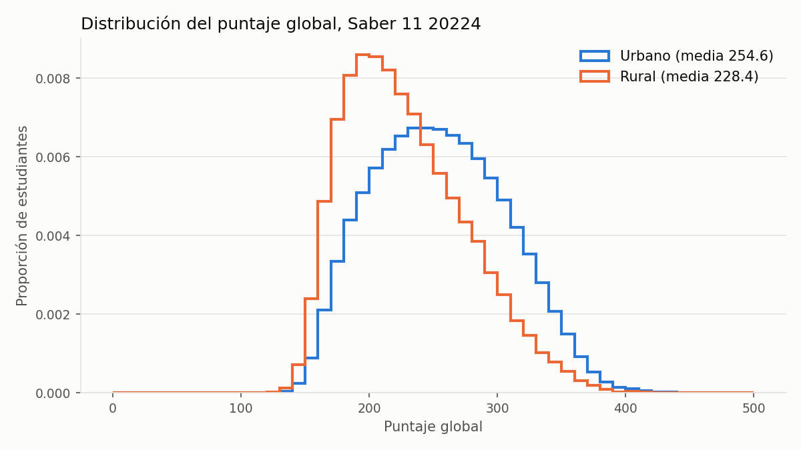
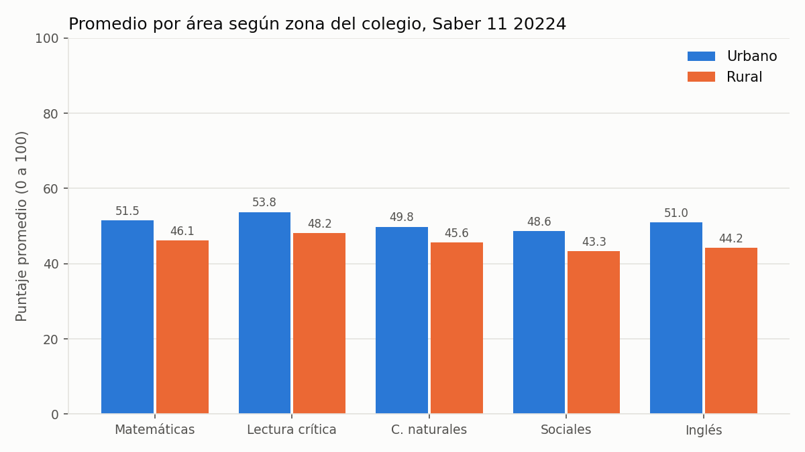
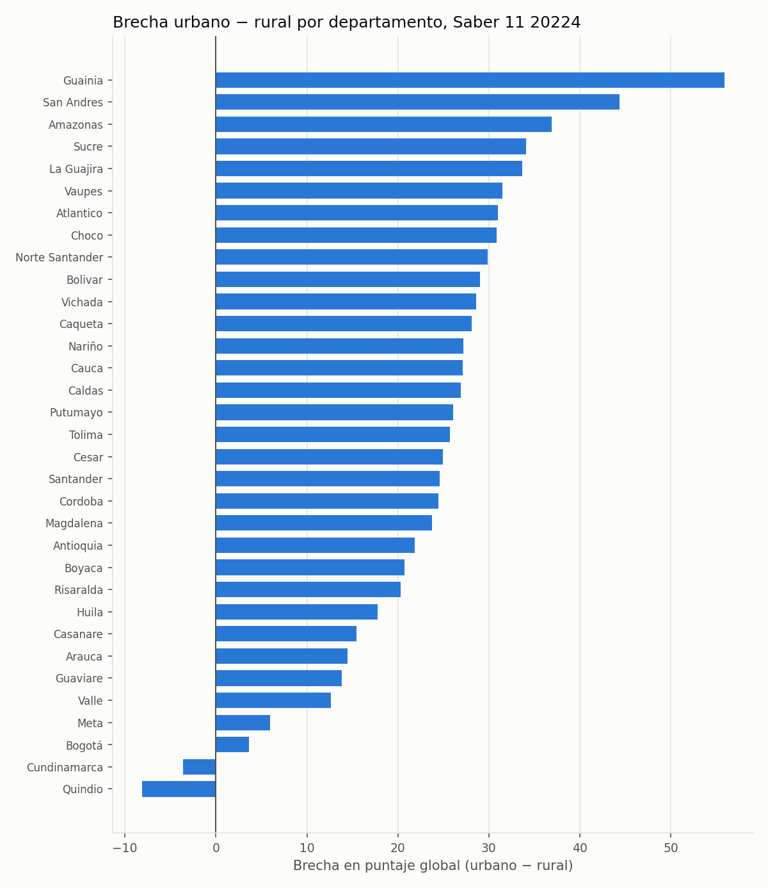

# Proyecto: Brecha rural vs urbana en Saber 11

## Pregunta de análisis
¿Cuántos puntos de diferencia hay en Saber 11 entre los estudiantes de colegios urbanos y rurales en Colombia? ¿La brecha se mantiene cuando se compara dentro del mismo tipo de colegio (oficial o no oficial) y del mismo estrato? ¿En qué departamentos es más grande?

El resultado sirve para orientar dónde focalizar programas e inversión en la educación rural.

## Fuente de datos
- Conjunto: Resultados únicos Saber 11
- Entidad: ICFES, publicado en datos.gov.co
- Enlace: https://www.datos.gov.co/Educaci-n/Resultados-nicos-Saber-11/kgxf-xxbe
- Licencia: Creative Commons Atribución-CompartirIgual 4.0 Internacional (CC BY-SA 4.0)
- Periodo analizado por defecto: `20224` (2022, calendario A), el más reciente del conjunto

Los datos se descargan con la API pública de datos.gov.co, filtrados por periodo y solo con las columnas necesarias. No se versionan: se regeneran con el contenedor.

## Variables
| Variable | Uso |
|---|---|
| `cole_area_ubicacion` | Zona del colegio: URBANO o RURAL (variable de comparación) |
| `punt_global` | Puntaje global, 0 a 500 (variable principal) |
| `punt_matematicas`, `punt_lectura_critica`, `punt_c_naturales`, `punt_sociales_ciudadanas`, `punt_ingles` | Puntajes por área, 0 a 100 |
| `cole_naturaleza` | OFICIAL o NO OFICIAL (para comparar dentro del mismo tipo de colegio) |
| `fami_estratovivienda` | Estrato del estudiante (para comparar dentro del mismo estrato) |
| `cole_depto_ubicacion` | Departamento (para ver dónde la brecha es mayor) |

## Método
1. `src/descargar.py` descarga el periodo y lo guarda en `datos/` ordenado de forma fija, para que dos descargas iguales tengan la misma huella SHA-256.
2. `src/analisis.py` limpia los puntajes y calcula:
   - Resumen por zona: estudiantes, media, mediana y desviación del puntaje global, y media por área.
   - Brecha urbano − rural según tipo de colegio, estrato y departamento (departamentos con al menos 100 estudiantes rurales).
   - Prueba t de Welch, intervalo de confianza del 95 % de la diferencia y tamaño del efecto (d de Cohen).
   - Tres gráficas: distribución del puntaje global, promedio por área y brecha por departamento. Una copia de las del periodo 20224 está en `figuras/` para mostrarlas en este README.
   - `manifiesto.json` con la huella SHA-256 de los datos y de cada salida, y las versiones de las bibliotecas.

## Herramientas
- pandas y scipy para el análisis, matplotlib para las gráficas.
- Docker para fijar el entorno, con versiones exactas en `requirements.txt`.

## Cómo reproducir
Desde la raíz del repositorio, en el codespace:

```bash
docker build --tag proyecto:0.2 proyecto/
docker run --rm \
  --volume "$(pwd)/proyecto/datos:/app/datos" \
  --volume "$(pwd)/proyecto/salidas:/app/salidas" \
  proyecto:0.2
```

Para otro periodo: agregar `-e PERIODO=20194` (por ejemplo, 2019 calendario A, antes de la pandemia).

La primera ejecución descarga cerca de un millón de registros y tarda varios minutos. Las siguientes reutilizan el CSV de `datos/`.

## Resultados (periodo 20224)

Se analizaron **1.065.886 estudiantes**: 883.458 de colegios urbanos y 182.428 de colegios rurales.

### 1. La brecha general es de 26 puntos
| Zona | Estudiantes | Media global | Mediana | Desv. estándar |
|---|---|---|---|---|
| Urbano | 883.458 | 254,63 | 252 | 51,58 |
| Rural | 182.428 | 228,39 | 222 | 47,39 |
| **Brecha (U − R)** | | **26,24** | **30** | |

- Prueba t de Welch: diferencia de 26,24 puntos, intervalo de confianza del 95 % entre 26,00 y 26,48. El valor p es menor que 0,001 (el programa lo muestra como 0.0 porque es tan pequeño que se redondea a cero), así que la diferencia no se explica por azar.
- Tamaño del efecto: d de Cohen = 0,52, un efecto **mediano**. La brecha es real y además importante en la práctica.



### 2. Todas las áreas muestran brecha; la mayor es en inglés
| Área | Urbano | Rural | Brecha |
|---|---|---|---|
| Inglés | 51,01 | 44,25 | **6,76** |
| Lectura crítica | 53,75 | 48,18 | 5,57 |
| Matemáticas | 51,51 | 46,12 | 5,40 |
| Sociales | 48,61 | 43,34 | 5,27 |
| C. naturales | 49,81 | 45,58 | 4,23 |



### 3. Según el tipo de colegio, la brecha cambia de sentido
| Tipo de colegio | Media urbano | Media rural | Brecha |
|---|---|---|---|
| Oficial | 248,62 | 224,50 | **24,12** |
| No oficial | 271,69 | 291,12 | **−19,43** |

En los colegios oficiales, que concentran el 94 % de los estudiantes rurales, la brecha se mantiene en 24 puntos. En los no oficiales se invierte: los rurales sacan 19 puntos más. Son solo 10.656 estudiantes, y una posible explicación (por verificar) es que en ese grupo hay colegios privados campestres ubicados en zona rural cerca de las ciudades.

### 4. La brecha crece con el estrato
| Estrato | Brecha |
|---|---|
| Sin estrato | 13,54 |
| Estrato 1 | 14,25 |
| Estrato 2 | 21,12 |
| Estrato 3 | 30,37 |
| Estrato 4 | 40,92 |
| Estrato 5 | 42,64 |
| Estrato 6 | 43,79 |

El puntaje rural se mantiene casi plano (entre 205 y 236) sin importar el estrato, mientras que el urbano sube con el estrato. Por eso la brecha es pequeña en estrato 1 y grande en los estratos altos. Los grupos rurales de estratos 5 y 6 son pequeños, así que esos valores deben leerse con cuidado.

### 5. Por departamento
- **Mayor brecha:** Guainía (55,90), San Andrés (44,33), Amazonas (36,89), Sucre (34,09) y La Guajira (33,70).
- **Menor brecha:** Valle (12,65), Meta (5,93) y Bogotá (3,64). En Cundinamarca (−3,64) y Quindío (−8,15) los rurales superan a los urbanos.



### Conclusión
Los estudiantes de colegios rurales obtienen en promedio 26 puntos menos en el puntaje global de Saber 11, con un efecto mediano y presente en todas las áreas, sobre todo en inglés. La brecha se concentra en el sector oficial y es más grande en departamentos periféricos (Guainía, San Andrés, Amazonas, La Guajira) que en los del centro del país.

### Siguiente paso
Correr el mismo análisis para `20194` (2019, antes de la pandemia) y comparar si la brecha rural aumentó después de la educación virtual.

### Huellas de referencia (periodo 20224)
```
8091e7e5bbee4189680914ee1975a78c2372b78f2ef7245c15ff7e8b176bb5c8  datos/saber11_20224.csv
16c6c62ede9092d21e4df67c8a8706791ff87b91d78122606d3bed6de688665c  resumen_zona.csv
1fe53f3aacb1fbc94b67201337d34581e3b9e7df4940b86ad990074e9642eae5  brecha_naturaleza.csv
bb5232ce994e7d987564f8c88518edc1217e2885e076398395d7cf3820df813f  brecha_estrato.csv
ee734d576f6bb1e7815fefb6e3a16d5ad185046ab3b84acc2cdb5dc86fd524a0  brecha_departamento.csv
```
